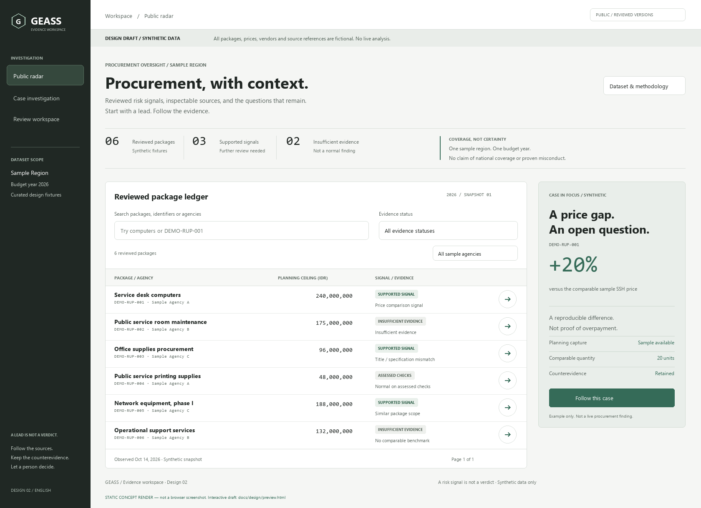

# GEASS design 02 — Evidence workspace

Status: design proposal, 2026-10-15. Redesigned with the **design-taste-frontend** skill following the user's English-language request. Open [the interactive preview](preview.html) in a browser. All records and source locators are synthetic; there are no external requests or backend integrations.

This is a static concept rendering, not a browser screenshot. The HTML also contains the investigation and reviewer screens.

## Design direction

- **Audience:** journalists, civic watchdogs and inspectors following evidence-backed procurement leads.
- **Character:** a restrained investigation workspace, with the emphasis on legible documents and source boundaries.
- **Layout:** charcoal workspace sidebar; pale ledger; asymmetric sample-case spotlight. Case detail becomes a continuous evidence document with an unboxed source rail. Metrics use inline dividers rather than three equal cards.
- **Typography:** sans-serif only. Geist / Geist Mono are preferred local fonts, with Segoe UI / Consolas fallbacks; no font downloads or dependencies. The title is 36 px on desktop and 30 px on mobile.
- **Palette:** neutral surfaces and one muted green accent. Evidence states are communicated by words and contrast, not separate traffic-light colors.
- **Motion:** short pressed/hover feedback and a layout-sized loading skeleton. Reduced-motion preference disables animation. Existing bounded-analysis and accessibility decisions take precedence over the skill's decorative perpetual-motion suggestions.
- **Signature:** a case spotlight pairs a measurable difference with its unresolved question; the evidence rail keeps every source and gap beside the finding.

The user requested a draft rather than application creation. This remains dependency-free HTML/CSS/JavaScript; the later application is still the accepted React/TypeScript/Vite stack. No React, Tailwind or icon package is installed for this prototype. Icons are small SVG primitives with consistent 1.5 px strokes.

## Authority

[Specification](../../.scratch/geass-wayfinding/spec.md) and [build plan](../geass-build-plan.md) govern behavior and sequence. The six ADRs remain intact:

- [Focused demo](../adr/0001-focused-evidence-demo.md): synthetic scope is clearly disclosed; no real regional case or national coverage is claimed.
- [Cloud Run web stack](../adr/0002-google-cloud-single-deployment.md): the HTML is a review artifact, not app scaffolding.
- [Review before publication](../adr/0003-review-before-publication.md): private drafts and reviewed public fixtures stay distinct.
- [Bounded batch analysis](../adr/0004-bounded-resumable-analysis.md): browsing never runs inference; the inspector is explicitly simulated.
- [Evidence abstention](../adr/0005-evidence-and-deterministic-signals.md): missing evidence does not become normal or an invented price difference.
- [SQL edges / draft dossiers](../adr/0006-sql-graph-and-draft-dossiers.md): observed relationships do not establish ownership; downloads are Markdown drafts, never automatic submissions.

## Screen map

| Surface | Hierarchy | Draft interactions |
| --- | --- | --- |
| Public radar | Scope → inline coverage summary → ledger and case spotlight | Search, agency/evidence filters, case selection, populated/loading/empty/error previews |
| Case investigation | Reviewed version → planning facts → comparison and counterevidence → vendor observations | Source dialogs, insufficient-evidence state, graph with table equivalent, separate PPID / audit sample downloads |
| Evidence trail | Planning → applicable benchmark → verified execution link → review | Explicit gaps; inspector changes with available case coverage |
| Review workspace | Private draft → readiness → arguments → exact-version decision | Required note, local approve/reject feedback, reset; labeled role simulation |

The public fixture list excludes the private reviewer draft. Simulated review does not modify the public radar or submit a server record. The real implementation must enforce authentication, role checks, version conflicts, withdrawal and artifact access separately.

## Tokens

| Role | Value |
| --- | --- |
| Canvas / document | `#f5f6f4` / `#ffffff` |
| Sidebar / selected navigation | `#202824` / `#35483d` |
| Text / secondary / quiet | `#202623` / `#59645e` / `#647068` |
| Border | `#d8ded9` |
| Accent / accent surface | `#356b58` / `#e9f0eb` |
| Sidebar text / secondary | `#ffffff` / `#c4cec7` |
| Spacing | 4, 8, 12, 16, 24, 32, 36 px |
| Type | 11 px locators, 13 px ledger, 15–16 px mobile body, 21 px sections, 36 px page title |
| Radius | 5 px controls, 8 px document/ledger, 10 px modal |
| Controls | 44 px primary/touch targets; 2 px focus ring; 150 ms pressed/hover feedback |

Prices remain IDR. English display formatting uses `240,000,000`; identifiers and numbers use tabular monospace. Proper source-system terms such as SIRUP, RUP, SSH, LPSE, PPID, APIP, BPK and RAB are preserved, with explanatory English copy.

## Responsive and state behavior

- At wide desktop sizes, a 216 px sidebar anchors the ledger/spotlight and document/evidence-rail layouts.
- Below 1024 px the spotlight, evidence rail and review columns stack. Below 768 px the sidebar becomes compact horizontal navigation, all asymmetric content becomes one column, and ledger rows become labeled cards.
- Search and agency/evidence filters keep explicit labels. State messages distinguish loading/access failure/empty results from evidence conclusions; there is no animated live-monitoring claim.
- Use native controls, a skip link, focus rings, landmarks, live result counts and dialogs with Escape/return-focus behavior. The graph has a textual relationship table. Source/model text is inserted as text rather than interpreted HTML.
- Source locators are fictional, not fabricated links to actual regulations. Draft downloads disclose synthetic identity, amounts, evidence limits and manual recipient/requester fields.

No external component inspiration or added dependency was needed. [Validation notes](validation.md) state what was checked and the remaining browser-validation boundary.
