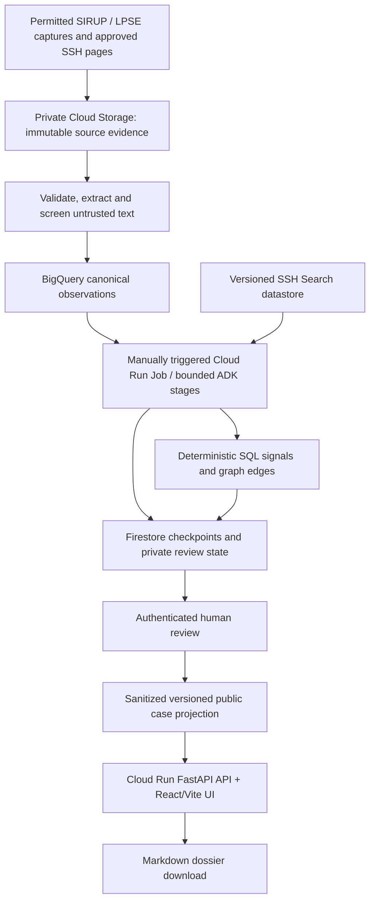

# GEASS sequenced build plan

Planning baseline: 2026-10-14, Asia/Jakarta. Status: ready to slice into implementation tickets; execution starts with the readiness gate below. No production code or infrastructure is created by this plan.

The [GEASS demo specification](../.scratch/geass-wayfinding/spec.md) defines the product behavior and acceptance contracts derived from this plan and the resolved wayfinder map.

The target is one reproducible, evidence-backed procurement investigation for one region/year, with a public reviewed view, a vendor evidence graph when accessible records support it, and downloadable draft dossiers. The full PRD remains the product vision, not the initial delivery commitment. The original four-day timeline is an aspiration, not an estimate; estimate tickets after the data and cloud gates establish their actual work.

## Decision record

| Decision | Governing record |
| --- | --- |
| Focused demo; region/year selected through evidence | [Focused evidence demo](adr/0001-focused-evidence-demo.md) |
| Google Cloud, Python/FastAPI, React/TypeScript/Vite, one web/API deployment | [Google Cloud single deployment](adr/0002-google-cloud-single-deployment.md) |
| Human review before public exposure | [Review before publication](adr/0003-review-before-publication.md) |
| Manually triggered durable batch analysis | [Bounded resumable analysis](adr/0004-bounded-resumable-analysis.md) |
| Source provenance, deterministic checks, evidence abstention | [Evidence and deterministic signals](adr/0005-evidence-and-deterministic-signals.md) |
| SQL graph edges; downloadable Markdown first | [SQL graph and draft dossiers](adr/0006-sql-graph-and-draft-dossiers.md) |

User-selected boundaries are accepted. Operational implementation recommendations below, including Firestore and the exact authentication integration, should be validated in the readiness slice; changes that alter accepted boundaries return to the decision map.

## PRD corrections that reach the build

- Public source existence does not prove a stable anonymous API, uniform schema, usable quantities, or complete bidder/evaluation data. PRD package IDs and example allegations are not verified cases. Start with permitted captures and document field coverage.
- A planning ceiling is not an invoice or paid contract amount. `1 Paket` is not a defensible item quantity. Retail observations and legal price standards are different evidence types.
- Thresholds depend on category and effective regulation. Current documented direct-procurement ceilings are Rp200 million for goods/other services, Rp400 million for construction, and Rp100 million for consultancy; proximity alone does not prove intentional splitting.
- RUP links can change and need not be one-to-one. Tender identities need portal scope. A registered participant is not necessarily a bidder.
- Shared addresses, fuzzy names, and masked NPWP are candidate associations, not beneficial-ownership proof.
- BigQuery Graph is real, but GQL reservation requirements are deferred. The demo uses SQL and precomputed graph projections.
- Both PRD Gemini 2.5 models are documented to retire on October 20, 2026. Select a supported GA model through a project-specific smoke test and small evaluation; do not mechanically replace model names without checking structured output and tools.
- Model Armor has skipped/unsupported cases and does not establish complete protection. Indonesian injection detection needs testing. Scan status is a hard input to analysis eligibility.

Sources and exact verification limits: [procurement research](research/procurement-data-feasibility.md), [cloud research](research/google-cloud-feasibility.md). Competition requirements, eligibility, submission deadline, and judging weights have not been checked; confirm official rules before tailoring delivery to them.

## Intended architecture

Suggested layout at implementation: `backend/` for FastAPI, schemas, pipeline, adapters, and tests; `frontend/` for Vite/React; `data/fixtures/` for redistributable sanitized test fixtures; `docs/` for decisions/evidence; deployment config only when the readiness gate chooses project/region. Do not scaffold it during wayfinding.

Cloud Storage preserves source bytes, checksums, parsed page references, and generated artifacts. BigQuery holds analytical observations and versioned derived results. Firestore supports job/stage state, reviewer authorization, review decisions, and public case pointers; durable commits and conditional updates prevent duplicate execution and stale publication. The initial demo has one authorized batch operator and a small reviewer allowlist, not a general account system.

Keep reviewer mutations in protected API routes with verified identity, server-side authorization, version checks, and CSRF protection where cookie auth is used. Public routes return only the approved projection; they cannot enumerate raw documents, drafts, masked tax data, private explanations, or job controls. Use separate job and web service identities, application-default Google credentials, Secret Manager only for secrets that are actually needed, and no credentials in frontend assets.

ADK uses narrow read/retrieval tools and parameterized queries; source text never supplies SQL, tool destinations, or instructions. Default to one supported model for normalization, semantic signals, and a bounded two-pass critic; add another model only when evaluation warrants the cost. Store structured rationale and evidence citations, not private chain-of-thought. Trace stage outcomes, request/run IDs, timings, model versions, and safe failure codes; exclude raw source/person data and credentials from telemetry.

## Data contracts to settle in tickets

| Record | Identity and minimum contract |
| --- | --- |
| Source capture | Source URL/portal, retrieval time, content hash, source version, permitted-access basis, raw object reference, parser version, field coverage; page locator for PDFs |
| Planning observation | Source-scoped `id_rup` as string, year, agency/satker, jurisdiction, decimal IDR pagu, method/category, raw description/specification/quantity, missing-field flags |
| Execution observation | Portal + tender ID as strings, observed RUP links with time/evidence, pagu/HPS where present, source-native vendor observations, separate registration/bid/evaluation/winner states |
| Lifecycle relation | Zero-to-many references, `verified` / `candidate` / `unavailable`, source locator, observation history; only verified references support combined findings |
| Benchmark row | Legal instrument/version, approved status, jurisdiction/year/effective date, page/row, item/specification/unit, decimal price, tax/logistics/applicability notes |
| Analysis run | Source revision + case ID + analysis version + model ID; stage status, attempts, limits, checkpoint, errors; never conflated with publication status |
| Signal | Rule/version, observation inputs, deterministic calculation if any, supporting and contradicting evidence, limitations, `supported` / `insufficient_evidence` / `not_assessed` |
| Vendor edge | Two source identities, edge type, evidence, date range, count/denominator; observed relation separate from identity merge |
| Review / published case | Reviewer identity/time, exact analysis/evidence version, approve/reject/withdraw, public projection version and source references |

Use nullable values plus explicit coverage flags rather than invented zeros. Preserve raw source fields and history; normalization is a derived view. Decimal math and unit normalization occur in validated Python/SQL, never in an LLM. Unknown tax treatment, year, specifications, or bundled quantities disable comparable-price claims.

## Delivery order and acceptance gates

These are milestones to slice later, not created implementation issues. Each ticket should deliver a user-observable vertical result, include the minimal negative case, and carry the milestone prerequisites. Do not make one ticket per agent or one enormous frontend ticket.

| Order | Milestone | Depends on | Concrete acceptance evidence |
| --- | --- | --- | --- |
| 0 | Establish execution inputs and source/cloud feasibility | Accepted ADRs | Budget cap, deadline, operator/reviewer owners, project/region and approved provisioning scope recorded; supported model smoke test; permitted source sample; region/year decision and coverage manifest |
| 1 | Read a provenance-backed package end to end | 0 | Curated source capture → canonical package → API → table/detail; exact source URL/time/hash visible; missing values remain missing; real/synthetic distinction shown |
| 2 | Compare one defensible quantity with one applicable SSH row | 1 | Validated extraction + exact PDF page retrieval + deterministic decimal comparison; unlike units, bundles, wrong year, absent source and missing citations abstain |
| 3 | Add evidence-backed planning signals and bounded debate | 2 | Title/spec and mandate assessments cite sources and counterevidence; split-rule inputs are effective-dated; invalid output, injection/scan failure and defense counterexample cannot become publishable findings |
| 4 | Follow a verified lifecycle link into a vendor graph | 1; 3 for combined case | Source-linked execution panel, bid/evaluation provenance, bounded SQL co-bidding/address edges; absent bidder fields show unavailable coverage; ambiguous identity never becomes a merge |
| 5 | Review and publish a case version securely | 3; 4 if graph is present | Authorized reviewer approves exact version; anonymous users see only approved projection; unauthorized writes, stale approval, draft reads and changed evidence are blocked; withdrawal removes public access |
| 6 | Download a source-backed draft dossier | 5 | Markdown PPID request and APIP/BPK brief contain correct identifiers, source locators, assumptions and counterevidence; clearly draft; download only, no submission or email |
| 7 | Demonstrate Cloud Run execution, recovery and judge flow | 1–6 | Real deployed cloud evidence, job kill/retry without duplication, bounded costs, safe trace, complete browser investigation/download path, explicit negative cases and recording |

### Milestone 0: go/no-go rather than a hidden assumption

Before provisioning or paid execution, the implementation task must obtain the user's project, billing authorization, maximum spend, region constraints, deadline, and reviewer identities. Budget alerts are notifications, not hard cost caps: also limit job invocations, model requests, concurrency, retries, dataset scope, and BigQuery bytes scanned. Capture source access/reuse terms and API/portal limits. Do not bypass access controls or infer an unrestricted API from a public page.

The source sample needs at least one authentic planning record, one defensible SSH comparison, and one verified execution relationship with the fields required for the proposed graph demonstration. Include a small missing-data and ordinary-case sample alongside candidate risks. The exact dataset size follows coverage and limits; 5,000 rows is not an initial acceptance condition.

If API access fails, use a permitted curated snapshot with provenance. If execution/evaluation data cannot be obtained, the real-data demo remains a planning radar with explicit unavailable graph coverage; a separately labeled synthetic graph can demonstrate behavior. Do not claim the full evidence-backed lifecycle demo passed. Revisit scope with the user if the reduced demonstration is insufficient. If no comparable SSH quantity exists, show abstention instead of inventing a markup example.

Check service-region compatibility, datastore import/retrieval, Model Armor semantics, IAM, Firestore transactional state handling, and trace export. No selected model or SDK version is locked before the smoke/evaluation gate. Capture the exact IDs/versions that pass and recheck lifecycle before the demo.

### Milestone 1: first usable vertical slice

Ingestion initially accepts a controlled operator-provided permitted capture, not anonymous uploads. Validate field types, amount bounds, encoding and source identity; keep rejected records inspectable without exposing them publicly. Raw files stay immutable and private. Make import idempotent by source revision and observation identity. Display package pagu as a planning ceiling, provenance and coverage beside every record.

Implement basic pagination, region/agency/signal filters, package detail and source navigation using precomputed case summaries. Set UI/API result limits; do not fetch national tables into the browser. This establishes the user path before adding multiple agent roles.

### Milestones 2–3: grounded assessment

Use structured extraction with explicit unknown fields, validation and source spans. Retrieval returns benchmark candidates and page references; deterministic checks decide comparability and price deltas. An index hit alone is not a verified benchmark match. Mandate assertions need an actual agency mandate reference; otherwise the agent raises a review question.

Keep provisional labels `ABSURD`, `INDICATED MARKUP`, `SPECIFICATION LOCK / TAILORED`, `SPLIT PACKAGE`, and `NORMAL` as PRD taxonomy with explanatory risk wording. Support multiple signals rather than forcing a single label. No signal-specific claim exists when its inputs are unavailable. High ratios and repeated near-threshold packages support review, not a conclusion of illegal conduct.

The critic runs a bounded prosecutor/defense exchange with evidence references and unresolved objections. An independent deterministic validator checks output completeness and references before marking the assessment reviewable. Screening errors/skips, absent evidence, and structurally invalid output leave the stage incomplete or insufficient; they cannot be overridden by an agent's confident explanation.

### Milestone 4: graph grounded in observations

Aggregate co-bidding only over known accessible tenders, reporting the observed window and denominator. Distinguish registered firms, actual bid submissions, evaluable bids, and final winners. High-bid-disqualification signals require known bid prices, evaluation states, and actual reasons; higher price alone is insufficient. Shared-address normalization creates an evidence edge, with raw provenance and uncertainty.

API graph projections enforce node/edge limits and support selected-case scope. The drawer provides a text/table equivalent for accessibility, explains edge types, and separates factual observations from model interpretation. Do not advertise a syndicate or common owner merely because nodes share an address.

### Milestones 5–6: public boundary and useful drafts

Pipeline state is separate from review state: `queued → running → completed / failed / quarantined`, followed by `draft → approved / rejected → withdrawn` for the reviewed version. Retry does not automatically republish. Changed source or analysis creates a new draft; the prior approved snapshot stays versioned until superseded or withdrawn under explicit review.

The public dataset is a sanitized projection, not an unrestricted query endpoint. Only whitelisted fields and supporting public locators are exposed; cache invalidation and artifact access must honor withdrawal. Fetching an old artifact URL must not bypass this boundary. Escape untrusted content in UI and dossier templates. Document retention/withdrawal rules before inviting real public users.

PPID wording is a draft request for records; APIP/BPK wording presents leads and evidence limits. Source legal/template references before presenting templates as legally appropriate. Validate locale, IDR amounts, recipient placeholders, document identifiers, and the difference between planning, HPS, bid and contract values. No personal accusation, auto-filled sender identity, or autonomous outbound communication.

### Milestone 7: verifiable demonstration

The browser story follows one permitted real case: table → source-backed detail → comparable benchmark → counterevidence → available vendor graph → reviewed public projection → draft download. Show insufficient evidence and a rejected unsafe input as separate negative cases. Record the deployed Cloud Run revision, successful BigQuery query/job, selected model call, enforced Model Armor verdict, and redacted stage trace.

Judge telemetry uses a sanitized inspector; a public user should not gain console access or raw traces. A screen recording of Cloud Console is separate evidence. Verify keyboard navigation, table/graph accessibility, loading/empty/error states, narrow viewport behavior, and citation destinations. A successful build or deployment alone does not prove this user flow.

## Minimal evaluation suite to carry into tickets

| Case | Required behavior |
| --- | --- |
| Comparable known quantity/SSH unit | Exact reproducible decimal calculation and evidence page |
| `1 Paket`, mixed bundle, zero/missing quantity | Abstain from item-price comparison; no fabricated unit |
| Wrong jurisdiction/year/draft SSH or incompatible unit | Reject benchmark applicability |
| Missing description/evaluation/bid | Disable dependent signal; never default to NORMAL or bidder failure |
| Lower bidder validly disqualified; relevant emergency/logistics exception | Preserve counterevidence and avoid unsupported anomaly escalation |
| Same masked NPWP/name/address on unrelated firms | Candidate edge only; no identity merge or ownership allegation |
| RUP link changes or one plan has several executions | Preserve observed history and one-to-many relation |
| Indonesian/English injection, encoded/oversize/scan timeout | Enforce screening disposition; no tool escape or publication |
| Invalid model JSON / absent grounding citation | Validation failure or insufficient evidence with bounded retries |
| Retry after persisted stage / duplicate trigger | Resume once; no duplicated findings or erased review |
| Anonymous/unauthorized/stale review or raw-object URL | Access blocked; exact approved projection remains the only public surface |
| Approved case withdrawn | Public API and artifact access cease; safe audit record preserved |

Use a small hand-reviewed evaluation set with provenance and visibly synthetic edge fixtures. Report precision/recall only against its stated labels and coverage, never extrapolate national accuracy. Calibration targets, acceptable latency and measured cost are set after initial evaluation with the actual model and sample, before scaling.

## How to slice the next work

Create implementation tickets only when asked, using the configured tracker or an explicitly selected local convention. Each ticket names its user result, dependencies, affected contracts, source evidence, minimum acceptance/negative case, test evidence, cost boundary, and out-of-scope items. Suggested first slices: readiness/source manifest; provenance-backed package read; validated SSH comparison. Later graph and dossiers build on those contracts rather than duplicating normalization or citation handling.

The map is complete when the architecture boundary is recorded and the build sequence is clear. Live data, service access and budget remain explicit implementation entry gates, not claims that wayfinding executed them.

## Deferred milestones

Nationwide recurring surveillance; GQL reservations and advanced traversal; Maps geocoding; AHU and citizen uploads; live retail/e-Katalog comparisons; PDF exports; automatic civic dispatch; operational SLAs and broad reviewer onboarding. Add them only after their source access, privacy, cost, and evaluation constraints are specified. Nothing in this plan declares production readiness.
